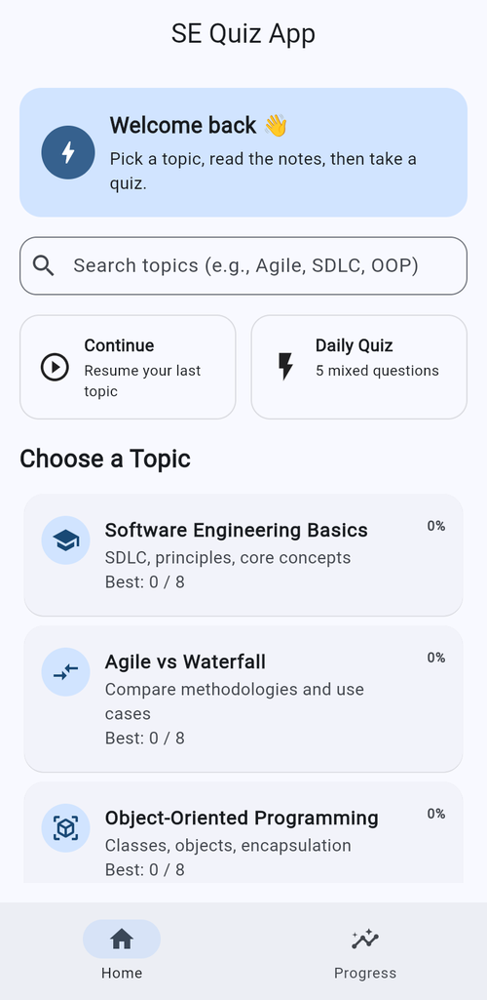
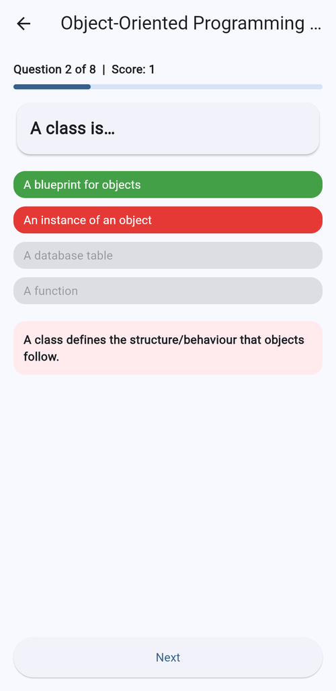
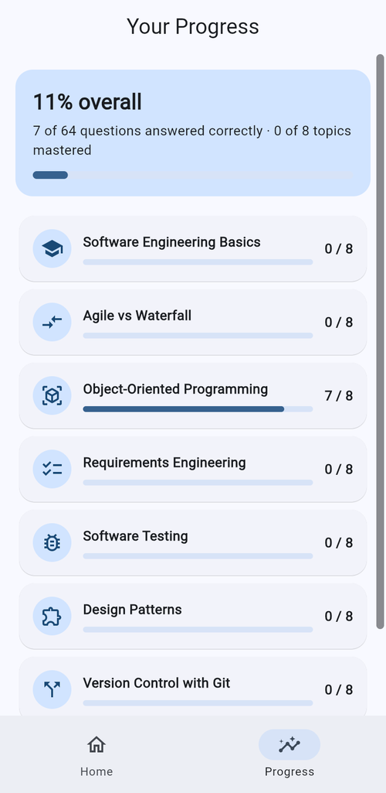
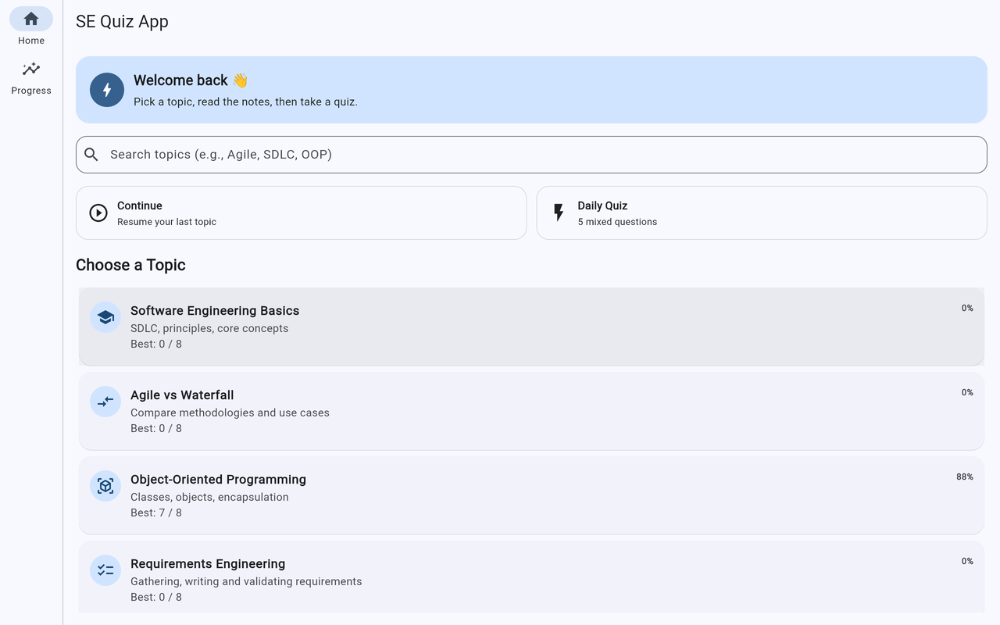
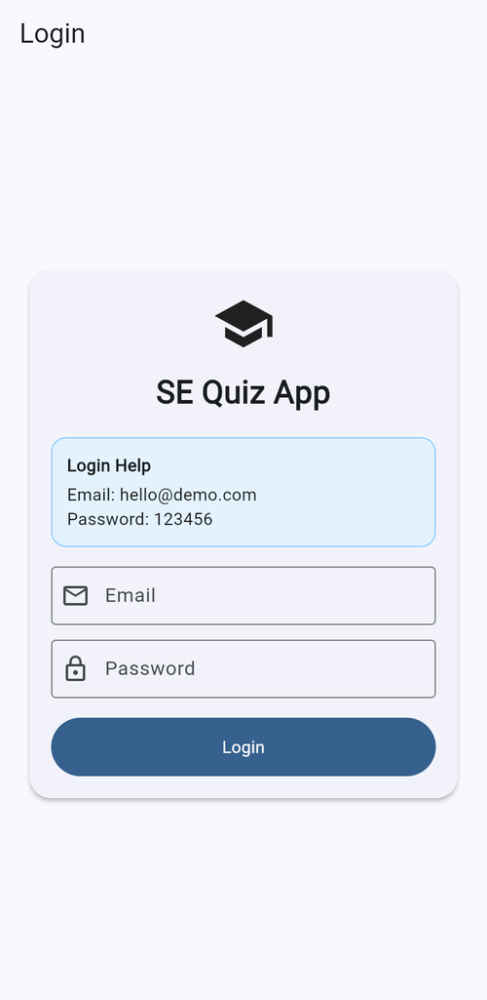
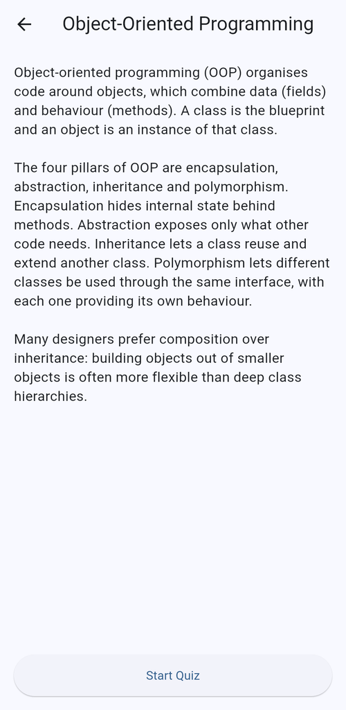
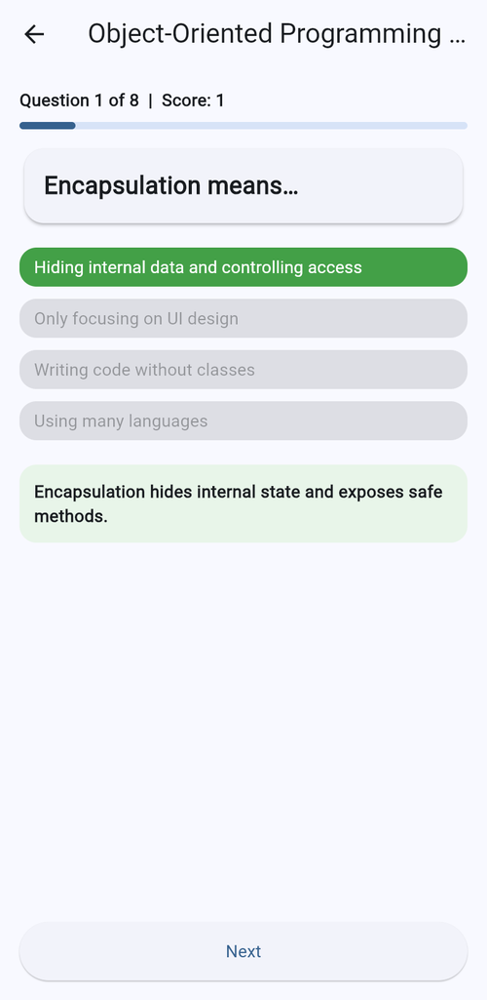
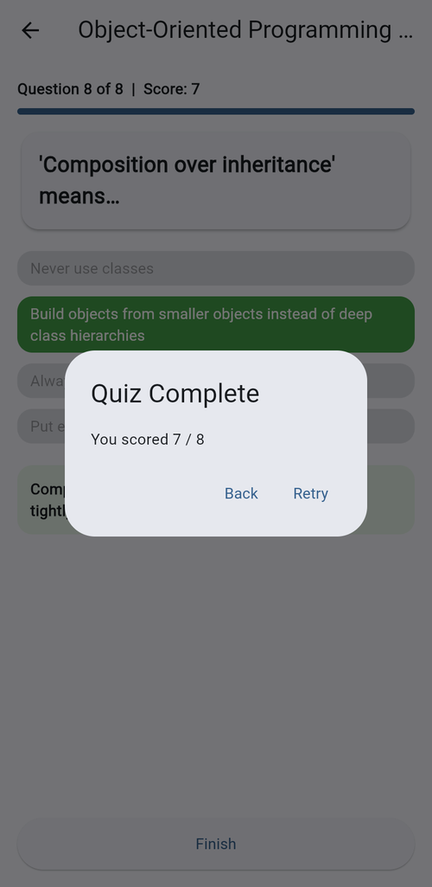

# SE Quiz App

[](https://github.com/Movaid03/se-quiz-app/actions/workflows/ci.yml)


A cross-platform revision app for software engineering students. Read short notes on a topic, take a quiz, get instant feedback with explanations, and track your best scores over time.

Built with Flutter as my final year project. It runs on Android, iOS, web and desktop from a single codebase.

**▶ [Try the live demo](https://movaid03.github.io/se-quiz-app/)** (demo login: `hello@demo.com` / `123456`)

<p>
  
  
  
</p>

## Features

- **8 topics, 64 questions:** SE basics, Agile vs Waterfall, OOP, requirements, testing, design patterns, Git and UML.
- **Read, then quiz:** every topic has revision notes followed by a multiple-choice quiz.
- **Instant feedback:** answers turn green or red, with an explanation for every question.
- **Progress tracking:** best scores are saved on the device and shown per topic and overall.
- **Daily Quiz:** 5 mixed questions from every topic, the same set for everyone each day.
- **Search:** filter topics as you type.
- **Continue where you left off:** jump back into the last topic you opened.
- **Responsive layout:** bottom navigation on phones, a navigation rail on tablets and desktop.



## Tech stack

| | |
|---|---|
| Framework | Flutter (Material 3) |
| Language | Dart |
| Local storage | `shared_preferences` |
| Testing | `flutter_test` (unit and widget tests) |
| CI/CD | GitHub Actions: analyze and test on every push, deploy the web build to GitHub Pages |

## Project structure

```
assets/
  questions.json         all topics, notes and questions (content is separate from code)
lib/
  main.dart              app entry point, theme and login screen
  home_screen.dart       responsive home: search, quick actions, topic list, navigation
  text_screen.dart       revision notes for a topic
  quiz_screen.dart       quiz flow, scoring and feedback
  progress_screen.dart   best scores per topic and overall
  progress_store.dart    saving and loading progress with shared_preferences
  topics.dart            loading topics from JSON and picking the daily quiz
  model.dart             Topic and Question models
test/                    unit and widget tests
```

## Getting started

You need the [Flutter SDK](https://docs.flutter.dev/get-started/install).

```bash
git clone https://github.com/Movaid03/se-quiz-app.git
cd se-quiz-app
flutter pub get
flutter run            # pick a device, or add -d chrome for the web version
```

Log in with `hello@demo.com` / `123456`. The login screen is a demo: it checks the input format but there's no real account system.

## Running the tests

```bash
flutter test
```

The tests cover the scoring and feedback in the quiz, saving best scores, search, navigation, the login checks, the daily quiz selection, and a check that every question in `questions.json` is valid.

## Adding questions

All content lives in [`assets/questions.json`](assets/questions.json), so new topics or questions don't need any code changes:

```json
{
  "text": "Which test checks a single function in isolation?",
  "options": ["Unit test", "System test", "Acceptance test", "Load test"],
  "correctIndex": 0,
  "explanation": "Unit tests focus on the smallest testable parts of the code."
}
```

Run `flutter test` afterwards. It will fail if a question has an invalid answer index or a missing explanation.

## Screenshots

| Login | Notes | Correct answer | Result |
|---|---|---|---|
|  |  |  |  |

## Future ideas

- Real user accounts and cloud sync (e.g. Firebase)
- Timed quiz mode and shuffled answer order
- Dark mode
- More topics such as security, databases and DevOps
